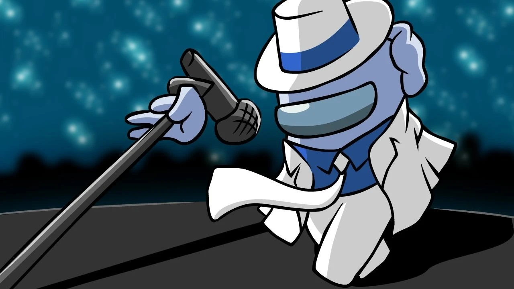
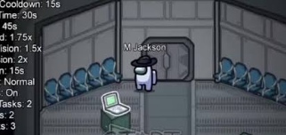

# Michael Jackson in Among Us

<p align="center">
  
</p>
<p align="center">
  
</p>

<p align="center">
  <b>A custom Impostor role for Among Us (PC) built with BepInEx 6 (IL2CPP) and Harmony.</b><br>
  Moonwalk past the crew, strike like a Smooth Criminal, and laugh your way through the vents.
</p>

---

## Table of contents

- [Features](#features)
- [Controls](#controls)
- [Requirements](#requirements)
- [Installation](#installation)
- [Adding the sound files](#adding-the-sound-files)
- [Configuration](#configuration)
- [Building from source](#building-from-source)
- [Project structure](#project-structure)
- [How it works](#how-it-works)
- [Known limitations](#known-limitations)
- [Contributing](#contributing)
- [Disclaimer](#disclaimer)

## Features

| Mechanic | Description |
|----------|-------------|
| **Impostor base** | Michael Jackson *is* a vanilla Impostor: kill, sabotage and use vents exactly like a normal Impostor. At the start of each match the host promotes one plain Impostor to Michael Jackson. |
| **Moonwalk Speed** | Press the ability key **or** quickly alternate left/right movement (left-right-left) to get a **1.5x speed boost** for a few seconds. Has a cooldown. |
| **Smooth Criminal kill** | When Michael Jackson kills someone, `hee_hee.wav` plays, followed by the classic `ow.wav`. The victim sees: ***"You've been struck by a Smooth Criminal!"*** |
| **Thriller vents** | `thriller_laugh.wav` plays whenever Michael Jackson enters or exits a vent. |

All numbers (speed, duration, cooldown, who hears each sound...) can be changed in the [config file](#configuration).

## Controls

| Action | Default input |
|--------|---------------|
| Moonwalk (speed boost) | <kbd>F</kbd> |
| Moonwalk gesture | Change horizontal direction 3 times within 0.75 s (e.g. <kbd>A</kbd> <kbd>D</kbd> <kbd>A</kbd> <kbd>D</kbd>) |
| Kill / Sabotage / Vent | Vanilla Impostor controls |

You get notifications in the bottom-left corner when you receive the role, when Moonwalk starts and when it is ready again.
Moonwalk can't be used while dead, inside a vent, or during meetings and ejections.

## Requirements

- **Among Us** for PC (Steam or Epic). See the build note in [Building from source](#building-from-source) about matching game versions.
- **[BepInEx 6](https://builds.bepinex.dev/projects/bepinex_be)** (Unity IL2CPP, x86 build), bleeding-edge release.
- **Every player in the lobby must have the mod installed**: role assignment is synced through a custom RPC.

## Installation

1. **Install BepInEx 6 (IL2CPP)**
   1. Download the *BepInEx Unity (IL2CPP) for Windows (x86)* bleeding-edge build.
   2. Extract it into your Among Us folder (the one with `Among Us.exe`).
      - Steam: right-click the game → *Manage* → *Browse local files*.
      - Epic: usually `C:\Program Files\Epic Games\AmongUs`.
   3. Start the game once and close it. BepInEx creates its folders on the first run (it can take a minute).

2. **Install the mod**
   1. Download `MichaelJacksonRole.dll` from the [Releases](../../releases) page, or [build it yourself](#building-from-source).
   2. Create the folder `BepInEx/plugins/MichaelJacksonRole/` and put the DLL inside it.

3. **Add the sound files**: see the next section.

Final layout:

```
Among Us/
├── Among Us.exe
└── BepInEx/
    ├── config/
    │   └── com.favoritedevx.michaeljacksonrole.cfg   ← created on first launch
    └── plugins/
        └── MichaelJacksonRole/
            ├── MichaelJacksonRole.dll
            └── Sounds/
                ├── hee_hee.wav
                ├── ow.wav
                └── thriller_laugh.wav
```

## Adding the sound files

> **No audio is included in this repository.** You must provide your own `.wav` files and make sure you have the right to use them.

Put your files in:

```
<Among Us folder>/BepInEx/plugins/MichaelJacksonRole/Sounds/
```

The mod creates the `Sounds` folder on first launch if it doesn't exist.

| File | Plays when | Who hears it (default) |
|------|------------|------------------------|
| `hee_hee.wav` | Michael Jackson kills a player | Killer and victim |
| `ow.wav` | Right after `hee_hee.wav` | Killer and victim |
| `thriller_laugh.wav` | Michael Jackson enters or exits a vent | Michael Jackson only |

- **Format:** uncompressed WAV (8/16/24/32-bit PCM or 32-bit float), mono or stereo. MP3/OGG renamed to `.wav` will **not** work.
- **Length:** keep clips short (under about 3 seconds).
- **Missing files** are skipped and a warning is written to `BepInEx/LogOutput.log`, so the mod still works without them.
- Volume follows the in-game **SFX** volume slider, multiplied by `Audio.Volume` in the config.

Tip: to convert a clip with [ffmpeg](https://ffmpeg.org/):

```bash
ffmpeg -i input.mp3 -ac 1 -ar 44100 -sample_fmt s16 hee_hee.wav
```

## Configuration

After the first launch, edit `BepInEx/config/com.favoritedevx.michaeljacksonrole.cfg`:

| Section | Key | Default | Description |
|---------|-----|---------|-------------|
| Role | `Chance` | `100` | % chance one Impostor becomes Michael Jackson. **Host's value is used.** |
| Moonwalk | `Key` | `F` | Ability key ([Unity KeyCode](https://docs.unity3d.com/ScriptReference/KeyCode.html) name). |
| Moonwalk | `SpeedMultiplier` | `1.5` | Speed multiplier while moonwalking (1.0–3.0). |
| Moonwalk | `Duration` | `3` | Boost duration in seconds. |
| Moonwalk | `Cooldown` | `15` | Seconds before the ability can be used again. |
| Moonwalk | `GestureEnabled` | `true` | Allow triggering via left/right alternation. |
| Moonwalk | `GestureFlips` | `3` | Direction changes needed for the gesture. |
| Moonwalk | `GestureWindow` | `0.75` | Time window (seconds) for the gesture. |
| Audio | `Volume` | `1.0` | Volume of custom sounds (0.0–1.0). |
| Audio | `PlayOwAfterHeeHee` | `true` | Play `ow.wav` after `hee_hee.wav`. |
| Audio | `KillSoundAudience` | `Self` | `Self` (killer + victim), `Nearby`, or `Everyone`. |
| Audio | `VentSoundAudience` | `Self` | `Self` (Michael Jackson only), `Nearby`, or `Everyone`. |
| Audio | `NearbyRadius` | `6` | Radius used by the `Nearby` audience. |

> `Nearby`/`Everyone` on the vent sound will give the Impostor away. That's on purpose: it's a balance knob for the lobby.

## Building from source

Requirements: [.NET 6 SDK](https://dotnet.microsoft.com/download) or newer.

```bash
git clone https://github.com/FavoriteDevX/Michael-Jackson-in-Among-Us.git
```

```bash
cd Michael-Jackson-in-Among-Us
```

```bash
dotnet build -c Release
```

The DLL ends up in `bin/Release/net6.0/MichaelJacksonRole.dll`.

To copy it to your game automatically after each build:

```bash
dotnet build -c Release -p:AmongUs="C:/Program Files (x86)/Steam/steamapps/common/Among Us"
```

**Matching the game version:** the game assemblies come from the `AmongUs.GameLibs.Steam` NuGet package (served by the BepInEx feed configured in `NuGet.config`). Its version **must match the Among Us build you play**. Override it without editing the project:

```bash
dotnet build -c Release -p:GameLibsVersion=<game-version>
```

## Project structure

```
├── MichaelJacksonRole.csproj      # Project file (BepInEx + game references)
├── NuGet.config                   # Adds the BepInEx NuGet feed
├── Sounds/                        # Placeholder: your .wav files go in the game folder
└── src/
    ├── Plugin.cs                  # BepInEx entry point + configuration
    ├── MichaelJacksonRole.cs      # Role state, host assignment, RPC sync
    ├── Abilities/
    │   └── MoonwalkAbility.cs     # Speed boost, key + gesture detection, cooldown
    ├── Audio/
    │   ├── WavLoader.cs           # WAV → Unity AudioClip decoder
    │   ├── SoundLibrary.cs        # Loads, caches and plays the sounds
    │   └── SoundAudienceFilter.cs # Self / Nearby / Everyone logic
    ├── Patches/
    │   ├── RoleAssignmentPatches.cs  # RoleManager.SelectRoles
    │   ├── RpcPatches.cs             # PlayerControl.HandleRpc
    │   ├── KillPatches.cs            # PlayerControl.MurderPlayer
    │   ├── VentPatches.cs            # PlayerPhysics.CoEnterVent / CoExitVent
    │   ├── HudPatches.cs             # HudManager.Update (per-frame tick)
    │   └── GameLifecyclePatches.cs   # Reset on game end / lobby
    └── Utilities/
        ├── Notifications.cs       # On-screen messages
        └── Scheduler.cs           # Simple delayed actions
```

## How it works

1. **Assignment:** a Harmony postfix on `RoleManager.SelectRoles` runs on the host after vanilla roles are chosen. It picks one player whose role is the plain `Impostor` and broadcasts their id with a custom RPC (`221`). Every client stores it in `MichaelJacksonRole`.
2. **Moonwalk:** each frame (`HudManager.Update`) the local Michael Jackson client checks the key and the horizontal velocity sign. When triggered it multiplies `PlayerPhysics.Speed`, then restores it after the duration. Movement is client-authoritative, so other players see the faster slide.
3. **Kill:** `PlayerControl.MurderPlayer` runs on every client after the server confirms a kill (the end of the PerformKill flow). A postfix checks that the killer is Michael Jackson and the kill succeeded, plays the sounds for the configured audience, and shows the Smooth Criminal message on the victim's screen only.
4. **Vents:** prefixes on `PlayerPhysics.CoEnterVent` / `CoExitVent` play `thriller_laugh.wav`.
5. **Audio:** WAV files are decoded by hand (`WavLoader`) into `AudioClip`s and played through the game's `SoundManager`.

## Known limitations

- **Private lobbies only.** Innersloth's modding policy does not allow mods in public matchmaking. Use private lobbies or a community/modded server.
- **Everyone needs the mod.** Unmodded clients ignore the role, and some servers may reject the custom RPC.
- **Game updates can break the mod.** Method names such as `MurderPlayer`, `CoEnterVent` or `Notifier.AddDisconnectMessage` can change between game versions. If something stops working, check `BepInEx/LogOutput.log` and the targeted game-libs version.
- **Config is per client.** Moonwalk values come from the Michael Jackson player's own config, not the host's. Agree on settings with your lobby.
- **No on-screen ability button yet.** The ability is bound to a key (and the gesture). A HUD button is on the roadmap.
- Only plain Impostors can become Michael Jackson (not Shapeshifters or Phantoms).

## Contributing

Issues and pull requests are welcome. Please:

1. Open an issue first for larger changes.
2. Keep code and comments in English.
3. Note the Among Us and BepInEx versions you tested with.

## Disclaimer

This is an unofficial fan-made parody mod. It is **not affiliated with, endorsed by, or sponsored by** Innersloth LLC, the Estate of Michael Jackson, MJJ Productions, Sony Music, or any rights holder.
"Among Us" is a trademark of Innersloth LLC. All other names and trademarks belong to their owners.

**No copyrighted audio is distributed with this project.** Users supply their own sound files and are responsible for having the rights to use them.
The cover images are fan art; all rights belong to their original artists.
